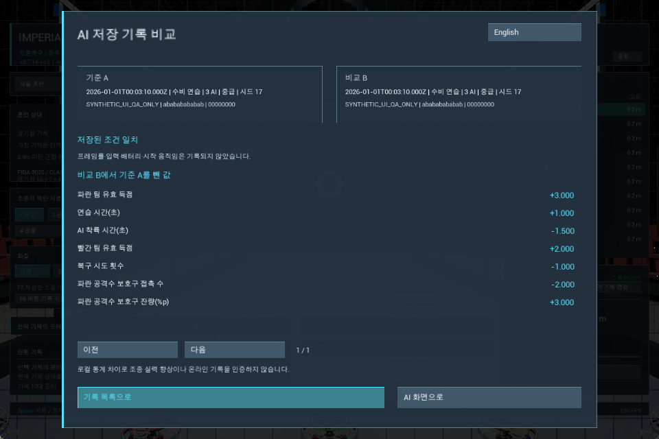
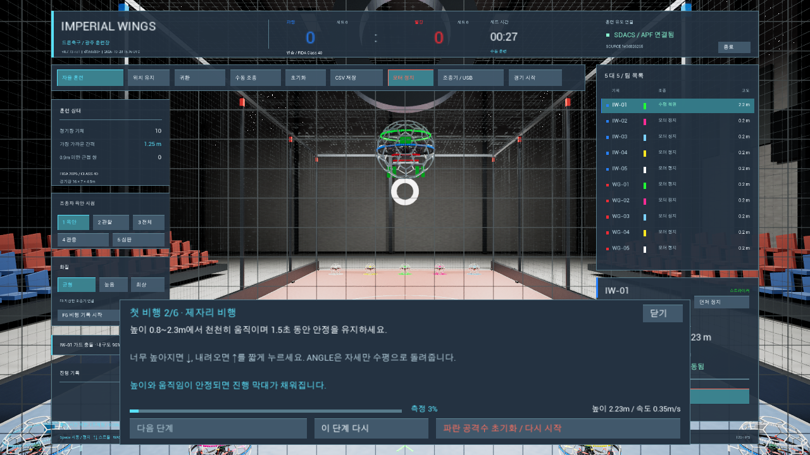
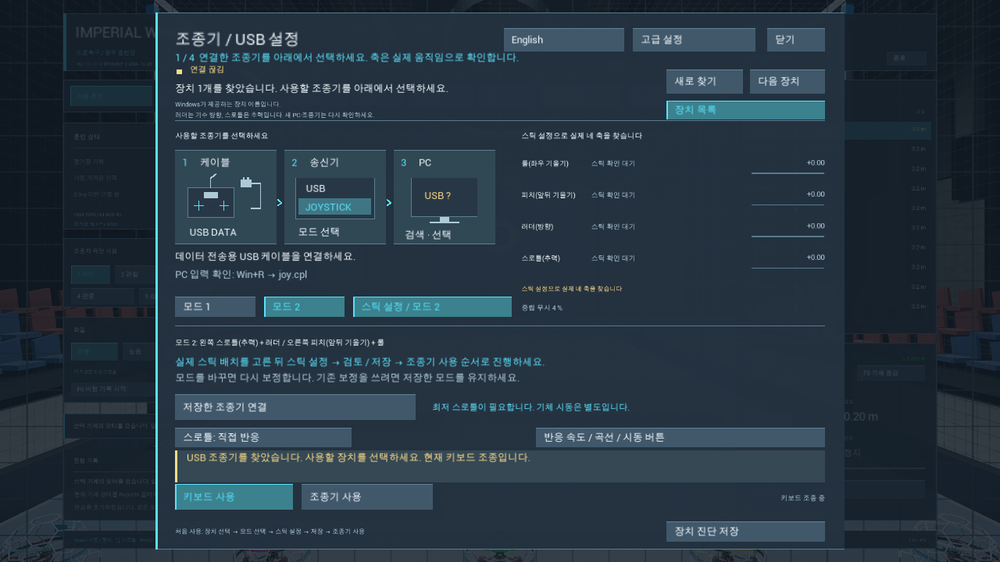
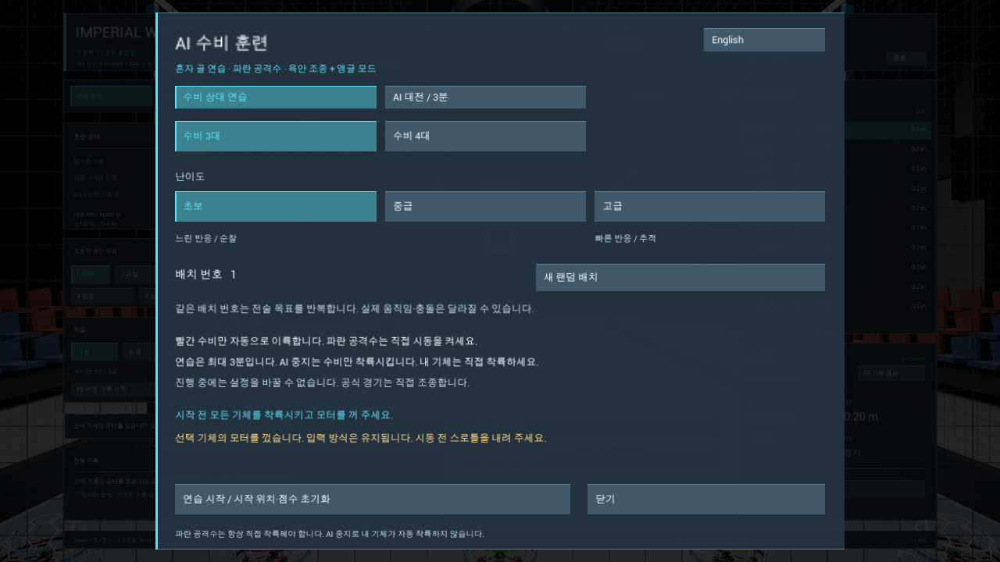
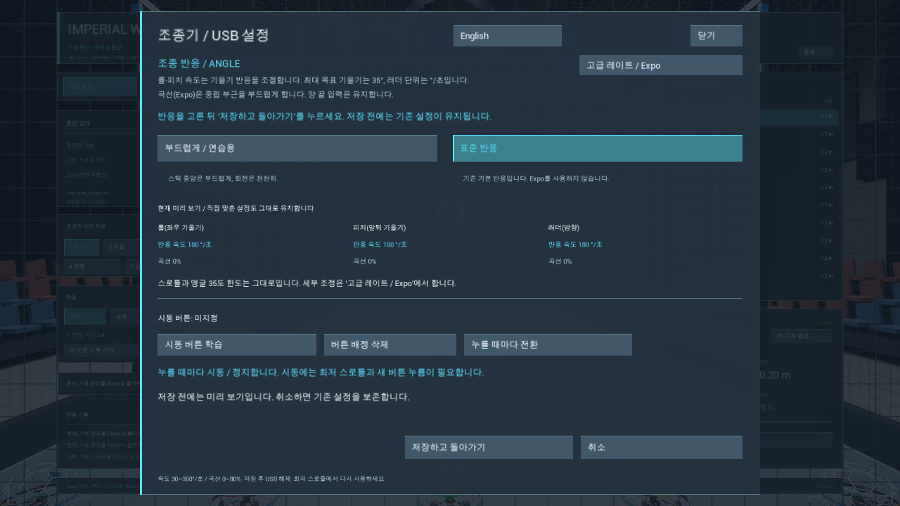
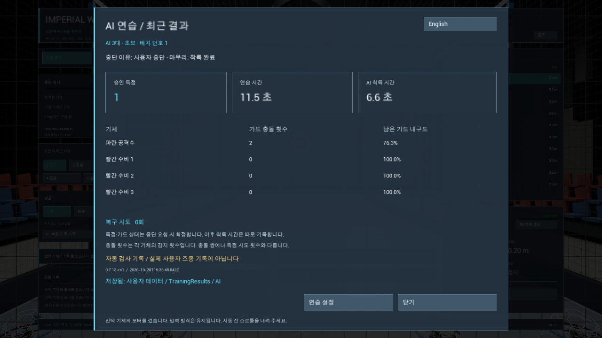

# Imperial Wings · 드론축구 시뮬레이터

[English](README.en.md)

> **최신 공개 시험판: v0.7.15-dev-safety3 · 2026-10-29 공개 · 정식 완성판이 아닙니다.**
>
> 다운로드와 검증 한계는 [safety3 릴리스 기록](https://github.com/sun475300-sudo/Drone-Soccer-Simulator/releases/tag/v0.7.15-dev-safety3)을 확인하세요. **main 게임 코드는 기존 v0.7.4 기반이며 safety3 소스가 통합된 상태가 아닙니다.** 이 공개판의 개발·빌드에는 [v0.7.15-dev-safety3 태그](https://github.com/sun475300-sudo/Drone-Soccer-Simulator/tree/v0.7.15-dev-safety3)를 사용하세요. README 갱신은 새 실행본 배포나 전체 작업 완료를 뜻하지 않습니다.

Windows에서 키보드나 USB 조종기로 연습하는 드론축구 시뮬레이터입니다. 기본 시점은 경기장 밖 LOS, 기본 비행은 ANGLE입니다. 모터 힘과 강체 물리로 비행하며, 실제 기체의 실측 특성을 보증하는 모델은 아닙니다.

**[safety3 설치 EXE](https://github.com/sun475300-sudo/Drone-Soccer-Simulator/releases/download/v0.7.15-dev-safety3/ImperialWings-Setup-0.7.15-dev-safety3.exe)** · **[safety3 Windows ZIP](https://github.com/sun475300-sudo/Drone-Soccer-Simulator/releases/download/v0.7.15-dev-safety3/ImperialWings-0.7.15-dev-safety3.zip)** · [SHA-256 목록](https://github.com/sun475300-sudo/Drone-Soccer-Simulator/releases/download/v0.7.15-dev-safety3/SHA256SUMS-safety3.txt) · [변경·검증 한계](https://github.com/sun475300-sudo/Drone-Soccer-Simulator/releases/tag/v0.7.15-dev-safety3) · [이전 v0.7.14-rc1](https://github.com/sun475300-sudo/Drone-Soccer-Simulator/releases/tag/v0.7.14-rc1)

## 로컬 개선 내역 — 2026-11-01 · 아직 미배포

**로컬 검증본 `0.7.18-local-los1`의 개발 기록입니다. 아래 개선은 현재 공개 safety3 다운로드나 main 게임 코드에 반영된 상태가 아닙니다.** 이번 GitHub 갱신 범위는 README 문서이며, 게임 코드·새 실행본 배포는 보류합니다. 모든 테스트는 사용자의 Windows PC에서 로컬로 수행했습니다.

| 개선 | 실제 동작 |
|---|---|
| 선택형 LOS 자동 기체 보기 | 경기장 밖 높이 1.70m의 파일럿 위치를 고정하고 선택 기체를 바라봅니다. 착륙하면 아래로 시선을 따라갑니다. |
| 독립 원거리 확대 | 자동 보기와 별도로 켜고 끕니다. 약 6~16m에서 FOV85°→65°로 완만하게 확대합니다. 두 옵션은 기본 OFF입니다. |
| 수동 조작·명시적 재개 | 우클릭 드래그는 자동 방향, 휠은 자동 확대만 멈춥니다. `기체 다시 보기`로 재개하고, 메뉴/HUD 위 입력과 창 전환을 구분합니다. 비행·ARM·USB 재연결은 자동 재개하지 않습니다. |
| 한국어 시점 설정 | 전체/F10 간소 HUD에서 설정을 엽니다. 착륙·DISARM한 자유 연습에서만 저장하며, 취소·기본값 초안·저장 실패 후 재시도를 지원합니다. |
| 설정·기록 보존 | 손상·미래 형식·잘못된 타입·빈/과대 설정 파일을 보존합니다. 호환 확장 필드를 유지하고 동시 저장 잠금 실패를 안내합니다. |
| 탑건 로컬 통합 | 앞선 로컬 S코스·닉네임/로컬 ID/선택 국가·시도/개인 최고 기록 기능을 포함합니다. 이번에는 추적/확대 옵션을 비교 조건에 추가해 다른 시점 설정의 기록을 섞지 않습니다. 국가·세계 순위는 후속입니다. |

**로컬 검증 결과:** Editor·Shipping 빌드 성공, 회귀 **37개 묶음 최종 통과**, LOS 계산99개, 설정 저장/재실행12사례58개, 실제 모터 힘·Chaos 비행20/60/240Hz 각각46개, GPU720p48개·1080p41개, 실제 Editor Play41개를 확인했습니다. 새 한글·공백 폴더에서33파일 해시와 실행을 다시 확인했으며 개인 조종기 보정은 보존했습니다. 테스트 스크립트의 구형 PowerShell 해시 명령 오류1건은 .NET SHA256으로 수정해 동일99개를 재검사했고 최초 실패 기록도 남겼습니다.

고정 시간 간격 검사는 실제 GPU FPS 측정이 아닙니다. Canvas 명령·진단용 포커스 대체를 사용하는 자동 검사는 실제 OS 마우스 전체 조작이나 실물 조종기 검증이 아닙니다. **미검증:** 실물 스틱/스위치·USB 케이블 재연결, 다른 PC/GPU, 고 DPI·1440p/4K·장시간 성능, 실측 물리 계수. 원거리 철망의 촘촘한 겹침은 실제 화면에서 재확인했으며 아직 해결되지 않았습니다.

검증한 로컬 소스 지문: `993698965a9d1dc7f41c5d953a9dda3657959ec1fdcfb920b8fd0673281a726f` (190개 빌드 입력). 이 지문은 공개 커밋·다운로드 파일을 뜻하지 않습니다. 전체 계획은 미완료이며 방향 보조·시인성/성능, 연습 중력과 공식 경기/기록 조건, 승인 득점 연출·시작/종료 알림, 정밀 물리·모델·심판·LAN/온라인 작업을 이어갑니다.

## 새 버전 업데이트 기록

### v0.7.15-dev-safety3

- 조종 응답·버튼·스로틀 설정을 명시적으로 저장할 때 미래 버전·손상 파일을 덮어쓰지 않도록 다시 확인합니다. 유효한 파일의 알 수 없는 필드는 유지합니다.
- 같은 잠금에 참여하는 새 버전들 사이에서 조종기 보정 파일 저장을 직렬화합니다. 구버전·외부 프로그램과의 동시 쓰기나 오래된 편집 내용의 충돌 병합까지 보장하지는 않습니다.
- AI 결과 저장이 실패하면 종료를 보류하고, 대전 중 종료 요청은 AI 착륙과 저장을 기다립니다. F6 기록 쓰기 실패 상태는 새 기록 시작이 성공할 때 해제합니다.

### 이전 v0.7.14-rc1

- **v0.7.14-rc1:** HUD 글자 크기·긴 문구·실제 장치명 표시를 개선하고, 게임 안에서 AI 저장 기록의 기준 A와 비교 B를 선택하는 화면을 추가했습니다. 다른 조건·버전·자동 검사·중도 종료·중복 세션은 차이 계산을 차단합니다.
- F6 기록 저장 실패 시 성공 안내가 실패 안내를 덮지 않도록 수정했습니다. 가드 파편의 빈 슬롯 갱신을 줄였으며 FPS 향상을 측정했다고 주장하지 않습니다.
- 새 소스 지문의 빌드·자동 회귀와 ZIP·설치기 검사를 구분해 [추가 업데이트 기록](docs/releases/v0.7.14-rc1.md)에 정리합니다. 실제 사람 기록·실물 Boxer·다른 PC·고 DPI 검사는 남았습니다.

## 시험 범위와 남은 확인

[safety3 릴리스 기록](https://github.com/sun475300-sudo/Drone-Soccer-Simulator/releases/tag/v0.7.15-dev-safety3)은 격리된 Unreal 자동 검사, AI 저장 실패·종료 재시도, 설정 파일 보존, ZIP CRC·해시와 portable 13/13·설치기 무등록 자동 검사 65/65를 보고합니다. 합성 입력·기록과 nullrhi 검사를 실물 조종이나 화면 검수로 보지 않습니다. 고정 시간 간격 검사는 실제 렌더링 FPS 측정이 아닙니다.

- **미검증:** 실물 Boxer 보정·비행·분리/재연결, 다른 물리 PC, 사람의 전체 첫 비행, 고 DPI와 실제 사람 기록 비교.
- **화면·설치 한계:** F6 오류 경고의 실제 한국어·영어 표시/겹침은 포커스 안전 중단으로 미확인입니다. 설치 GUI 전체 흐름, 공개 v0.7.14에서의 실제 업그레이드, 전원 차단·디스크 부족·권한 부족·SmartScreen은 미검증입니다.
- 피드백 양식의 실제 브라우저 검사도 접근 차단으로 미완료이며, 운영체제 강제 종료 시 미저장 AI 결과 보존을 보장하지 않습니다.
- 이후 독립 로컬 후보의 변경·시험 결과를 이 공개판에 포함되거나 검증된 것으로 합산하지 않습니다.

공개 태그 커밋은 [`c0787aba9b3db4f7f41224adfaeada6aa6be9512`](https://github.com/sun475300-sudo/Drone-Soccer-Simulator/commit/c0787aba9b3db4f7f41224adfaeada6aa6be9512)입니다. 릴리스 기록의 빌드 입력 지문은 `8187bde6de435f866f33792ff1663aeb2b81ad71bd782403f42481cd0ed3b167`(169개 입력)이며 시험 스크립트·문서는 이 지문에 포함되지 않습니다. 다운로드 파일은 위 SHA-256 목록으로 확인하세요.

## 실제 화면

아래 화면은 각각 표시한 **이전 버전**의 촬영본이며, safety3의 미검증 화면을 대신하는 근거가 아닙니다.

아래 **v0.7.14-rc1 ZIP 실행 화면**은 합성 시험 기록 두 개의 비교 예시입니다. 실제 사람의 성적이 아닙니다.

아래는 **v0.7.13-rc1 Windows 실행본**의 실제 화면입니다. 기획 이미지가 아닙니다. 촬영 해상도와 소스 지문은 [검증 기록](https://github.com/sun475300-sudo/Drone-Soccer-Simulator/blob/v0.7.13-rc1/docs/verification.md#v0713-rc1)에 구분합니다.

키보드 첫 비행은 **이륙 → 제자리 비행 → 이동 → 착륙 → 첫 골 → 마지막 착륙** 순서입니다. 안내는 실제 비행 상태와 득점을 관찰하며, 모터를 자동으로 켜거나 대신 조종하지 않습니다. 조건을 충족한 뒤 직접 ‘다음’을 누릅니다.

**C → 연결 그림**에서 DATA 케이블 → USB Joystick → 실제 장치 선택을 확인합니다. [Mode1/2 그림과 보정 순서](https://github.com/sun475300-sudo/Drone-Soccer-Simulator/blob/v0.7.13-rc1/docs/controller-visual-guide-2026-10-28.md)를 참고하세요. 기종마다 포트와 메뉴 표현은 다를 수 있습니다.

AI 수비 연습 또는 3분 대전을 선택합니다. 실행 중에는 대수·난이도·배치 변경이 잠기며, 종료·착륙 뒤 결과를 확인합니다. 공식 5대5 경기는 수동 조종입니다.

기본 설정에서는 부드러운 응답과 기본값을 미리 보고 선택할 수 있습니다. 세부 레이트·Expo·아밍 버튼은 고급 설정에서 바꿉니다. 설정은 저장을 눌러야 적용됩니다.

점수·비행 시간·AI 착륙 시간·기체별 접촉과 저장 상태를 구분합니다. 위 결과는 자동 진단으로 생성한 실제 화면이며 사람의 실전 성적이 아닙니다.

## 다운로드하고 실행하기

1. **설치 EXE**는 전체 프로그램을 담고 있습니다. 실행 후 **새 폴더 설치 / 기존 버전 업데이트**를 선택합니다. [설치·백업·제거 안내](https://github.com/sun475300-sudo/Drone-Soccer-Simulator/blob/v0.7.15-dev-safety3/Packaging/Installer/INSTALLER.md)를 먼저 확인하세요. ZIP 방식은 아래 순서를 따릅니다. GitHub `Source code` ZIP은 개발용입니다.
2. 새 폴더에 **전체 압축 해제**합니다. EXE 하나만 꺼내지 않습니다.
3. `ImperialWingsLauncher.exe`를 실행합니다. 옆의 `Windows`, `Guidance`, `Prerequisites` 폴더를 유지합니다.
4. Visual C++ 구성 요소가 없다는 메시지가 나오면 포함된 `Prerequisites/vc_redist.x64.exe`를 설치합니다.
5. 처음에는 조종기 화면에서 **키보드 사용 → 닫기**, 수동 연습에서 **F1 첫 비행 안내**로 시작합니다.

Windows 10/11 x64와 DirectX 12·Shader Model 6 지원 GPU가 필요합니다. Unreal Engine·Python·Git의 별도 설치는 필요하지 않습니다. 서명되지 않은 프로그램이므로 Windows 또는 브라우저에서 경고가 표시될 수 있습니다.

설치 EXE와 실행기를 포함한 ZIP을 제공합니다. 게임 내 신고창은 별도 시험 중입니다. 서로 다른 설치 폴더의 사용자 설정은 기본적으로 같은 `%LOCALAPPDATA%/ImperialWingsSimulator/Saved`를 공유합니다.

## 첫 비행

| 키 | 동작 |
|---|---|
| F1 | 첫 비행 안내 열기·닫기 |
| Space | ARM / DISARM — 최저 스로틀에서 모터 켜기 |
| ↑ / ↓ | 스로틀 올리기 / 내리기 |
| W / S | 앞 / 뒤 기울기 |
| A / D | 좌 / 우 기울기 |
| Q / E | 기수 회전 |
| 1 / 2 / 3 | LOS / 외부 관찰 / 경기장 전체 시점 |
| C | 조종기 설정 |
| F6 | 비행 기록 시작·저장 |

**↑/↓를 놓아도 스로틀은 유지됩니다.** ANGLE은 자세를 수평으로 복원하며 높이는 직접 조절합니다. 지면에 닿은 뒤 Space로 모터를 끕니다. 안내를 닫아도 비행은 계속됩니다. 착륙 뒤 첫 골 단계에서는 스로틀을 내리고 입력키를 놓은 다음 직접 ARM하여 재이륙합니다.

## USB 조종기 설정

1. 데이터 USB 케이블로 연결하고 조종기에서 Joystick 모드를 선택합니다.
2. 게임에서 실제 장치와 **Mode 1 / Mode 2**를 고릅니다. Mode 1은 오른쪽 위아래, Mode 2는 왼쪽 위아래가 스로틀입니다.
3. **스틱 설정**의 단계별 안내대로 전체 범위·중립·최저 스로틀을 보정합니다.
4. 결과를 검토해 **확인·저장**하고, 스로틀 최저·다른 축 중립에서 **조종기 활성화**를 누릅니다. 모터 ARM은 별도입니다.
5. 같은 장치를 다시 연결할 때는 **저장 조종기 연결 / F8**을 사용합니다. 연결만으로 비행을 재개하지 않습니다.

다른 PC에서는 실제 장치와 축을 다시 확인하세요. 보정값을 다른 조종기에 그대로 적용하지 않습니다. 한국어와 영어 전환을 제공하지만, 모든 내부 메시지가 번역된 상태는 아닙니다. 실물 Boxer의 스틱 방향·케이블 분리·재연결 비행과 다른 물리 PC 검사는 남아 있습니다.

## AI 연습과 기록

- **수비 연습:** 사람이 파란 공격수를 조종하고 빨간 수비 3대/4대와 연습합니다.
- **3분 대전:** 사람 공격수 1대 대 AI 총 3대/4대입니다. 빨간 공격수 1대와 수비 2대/3대가 참여합니다.
- 초급·중급·고급의 반응과 공격 이동을 단계적으로 조정했습니다. 골대 정렬·통과 안전 조건과 수동 조종의 힘 제한을 유지합니다.
- **AI 종료**는 AI 상대를 착륙시킵니다. 사용자의 기체는 직접 착륙해야 합니다.
- 결과 저장이 실패하면 미저장을 표시하며 재시도할 수 있습니다. 로컬 기록은 온라인 검증 기록이 아닙니다.

### 저장 기록 비교

AI 설정 또는 저장 완료 결과의 **저장 기록 비교**에서 기준 A와 비교 B를 직접 선택합니다. 원본 기록을 편집·삭제·전송하지 않으며, 비교 가능한 통계는 B−A로 표시합니다. 실력이나 동일한 실물 훈련 조건을 인증하는 기능은 아닙니다. 입력은 AI 결과 schema 1/2이며 F6 JSONL과 F5 CSV는 지원하지 않습니다. 목록은 파일명 순서 최대 100개이고 열기·새로고침 때 읽습니다. [조건·차단 이유·한계](https://github.com/sun475300-sudo/Drone-Soccer-Simulator/blob/v0.7.15-dev-safety3/docs/ai-result-comparison.md)를 확인하세요.

## 개발 상태와 의견 보내기

[전체 개발 계획·사용자 요청 20개](https://github.com/sun475300-sudo/Drone-Soccer-Simulator/blob/v0.7.14-rc1/docs/master-development-plan.md) · [국가·세계 리더보드와 다국어 후속 기획](https://github.com/sun475300-sudo/Drone-Soccer-Simulator/blob/v0.7.14-rc1/docs/follow-up-plan-2026-10-28.md) · [상세 기능 명세](https://github.com/sun475300-sudo/Drone-Soccer-Simulator/blob/v0.7.14-rc1/docs/simulator-feature-plan.md) · [과거 버전·개발 이력](https://github.com/sun475300-sudo/Drone-Soccer-Simulator/blob/v0.7.13-rc1/docs/history/README-before-v0.7.13.md)

나라별·세계 통합 리더보드, 추가 국가 언어, 혼합 5대5, 실물 조종기·다른 PC 검증은 후속 작업입니다. 전체 기능 완료나 실기체 인증을 의미하지 않습니다.

오류나 개선 의견은 [GitHub Issues](https://github.com/sun475300-sudo/Drone-Soccer-Simulator/issues)로 보내 주세요. 버전, 재현 순서, 기대한 결과와 실제 결과를 적고 공개할 내용을 확인한 뒤 직접 제출합니다. 개인정보나 개인 보정 파일은 첨부하지 않습니다. ZIP에 포함된 `feedback-form.html`에서도 보고서를 정리할 수 있습니다.

개발용 소스는 [v0.7.15-dev-safety3 태그](https://github.com/sun475300-sudo/Drone-Soccer-Simulator/tree/v0.7.15-dev-safety3)를 사용하세요. main의 문서 업데이트는 게임 코드·이력 통합 완료를 뜻하지 않습니다.