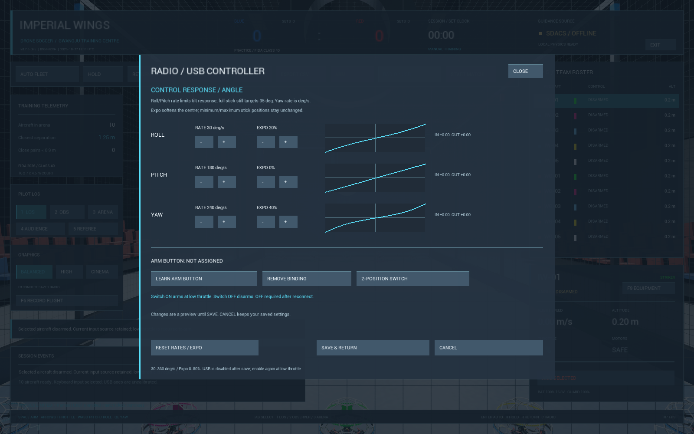

# 조종기 응답·아밍키 — v0.7.6-dev

이주한 피드백 중 사용자가 우선 지정한 조종기 설정 작업이다. 기존 단계형 Mode1/2 보정은
유지하고 Roll/Pitch/Yaw 레이트·Expo와 조종기 아밍 버튼 배정을 추가한다. DCL과 동일한
UI·모든 조종기 지원·전체12개 피드백 완료를 주장하지 않는다.

## 사용 순서

1. 모든 수동 기체를 착륙·DISARM하고 **RADIO / USB → RATES / EXPO / ARM**을 연다.
2. 축별 **RATE**를30~360deg/s, **EXPO**를0~80%에서 조절한다. 화면의 곡선과 IN/OUT은
   미리 보기다. 변경을 취소하면 저장된 값과 실제 비행 설정은 유지된다.
3. 아밍키를 지정하려면 연결된 조종기를 선택한 상태에서 **LEARN ARM BUTTON**을 누른다.
   지정할 버튼만 OFF/해제한 뒤 하나만 누른다. 다른 스위치는 그대로 두어도 된다. 여러 버튼이
   동시에 바뀌면 지정할 버튼을 놓고 다시 누른다. 버튼 번호와 선택 장치 일치 여부를 확인한다.
4. 순간 버튼은 **TOGGLE BUTTON**, 유지되는2단 스위치는 **2-POSITION SWITCH**를 선택한다.
   조종기의 USB 모드가 해당 스위치를 실제 버튼으로 보고해야 한다. 축으로만 전달되는
   보조 채널은 이번 버튼 배정 대상이 아니다.
5. **SAVE & RETURN**으로 저장한다. USB는 해제되므로 스로틀을 최저로 내리고 아밍키를
   OFF/해제한 후 **ENABLE RADIO / F8**로 다시 연결한다. 메뉴를 닫고 새로 눌러 ARM한다.
6. 재실행 후 값은 복원되지만 USB 활성화·ARM은 자동 복원하지 않는다. **REMOVE BINDING**은
   배정을 지우며 저장해야 적용된다. **RESET RATES / EXPO**는 응답값만 초기화하고 아밍키는 보존한다.

## 동작과 한계

- ANGLE35도와 LOS 기본 시점은 유지한다. Roll/Pitch 레이트는 기울기 복원 속도의 한도이며
  Expo는 목표 기울기로 들어가는 스틱 곡선을 바꾼다. Yaw 레이트는 끝 스틱의 회전 속도다.
  Acro/Betaflight 숫자와 같은 뜻으로 사용하지 않는다.
- 기본180deg/s·Expo0은 기존 결합 Roll/Pitch180deg/s 한도를 유지한다. 다른 축별 값은
  타원형 한도로 방향을 보존한다. 스로틀·정밀 스로틀·자동 고도 유지와 별도다.
- 높은 스로틀에서 버튼을 누른 뒤 계속 누른 채 스로틀만 낮춰도 ARM되지 않는다. 반드시
  OFF/해제 후 새로 눌러야 한다. DISARM은 높은 스로틀에서도 가능하다. 메뉴·포커스·기체
  전환 시 입력을 초기화하고 재연결 시 누른 채 유지된 버튼으로 자동 ARM하지 않는다.
- 아밍키는 WinMM이 보고한 장치 식별자에 결합한다. 동일 제조사/제품의 실제 일련번호를
  보장하지 않으며 슬롯이 바뀌면 다시 장치를 확인해야 한다. 현재 입력 범위는 WinMM6축·32버튼이다.
- `Config/PilotResponse.json`에 응답·배정만 원자적으로 저장하며 실제 축 보정
  `RadioProfile.json`, 정밀 스로틀 `PilotControls.json`을 덮어쓰지 않는다. 잘못된 파일은
  기본값·미배정으로 시작하되 원본을 수정하지 않는다. 쓰기 실패 시 이전 값으로 유지한다.
- 다른 PC·실물 USB 아밍 버튼·케이블 분리/재연결 시험은 연결된 하드웨어로 별도 확인해야 한다.

## 검증

검증 결과는 [검증 기록](verification.md#r10-controller-response)과
[기계 판독 결과](verification/controller-response-2026-10-27.json)에 기록한다.
합성 입력 시험은 명시적 진단 옵션과 격리된 사용자 폴더에서만 실행하며 실제 HID 입력이나
실물 보정 파일을 만들지 않는다. 정상 게임 실행에서 진단 입력은 활성화되지 않는다.

파일 교체는 기존 파일을 먼저 삭제하지 않는 Windows 호출을 사용한다. 기존 파일에 읽기
공유 잠금을 실제로 걸어 교체를 막은 시험에서도 파일 바이트와 현재 응답 설정이 보존됐다.
이는 시험한 Windows 로컬 저장 동작의 근거이며 전원 장애·네트워크 드라이브의 내구성까지
검증한 결과는 아니다.

첫 실행 검사에서0.6초 후 Roll의 부호가 항상 양수라고 가정한 검사가 실패했다.
자세 복원 중 반대 방향의 회전 명령은 정상이다. 단일 시점의 부호 대신 전 구간의 절대
각속도 한도와 실제 한도 도달을 검사하도록 수정했다. Yaw50%·Expo40%·240deg/s에서
실제 목표84deg/s가 되는 독립 계산값은 그대로 검증한다.
