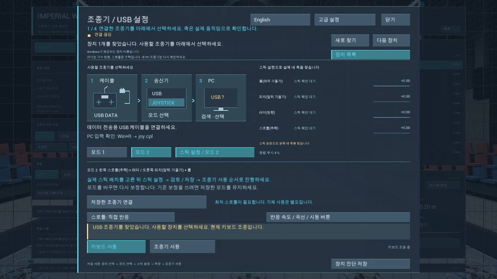
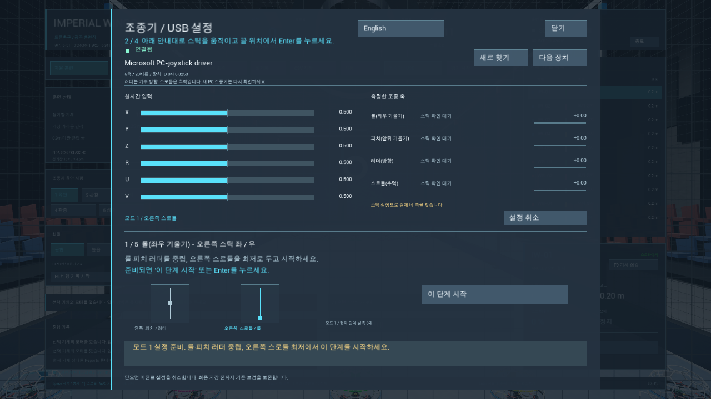
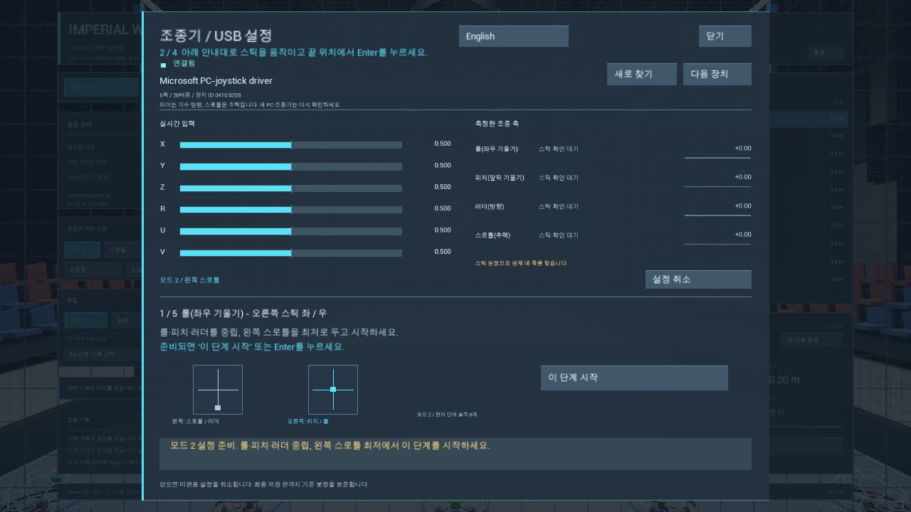

# 그림으로 조종기 연결·보정하기

v0.7.13-rc1 Windows 실제 화면입니다. 1280×720, 소스 지문 `c7feb1cfce27923bcc993e06bfb1736897ffb775858373dc3a88723636afc4c3`. 그림은 특정 조종기 제품 사진이나 포트 위치 안내가 아닙니다. 기종마다 데이터 USB 포트와 메뉴 이름이 다를 수 있습니다.

## 1. 케이블 → Joystick 모드 → 장치 선택

게임에서 **C → 연결 그림**을 누릅니다. 충전만 가능한 케이블 대신 데이터 전송 USB 케이블을 사용하고, 조종기 화면에서 USB Joystick 모드를 선택합니다. **장치 목록**으로 돌아와 실제 Windows 장치 카드를 고릅니다. 다른 장치가 보인다고 내 조종기가 연결된 것은 아닙니다.

장치가 안 보이면 **새로 찾기**, 데이터 포트·케이블·Joystick 모드를 확인합니다. Windows 입력 확인은 Win+R → `joy.cpl`에서 할 수 있습니다. 조종기가 없으면 **키보드 사용**으로 연습합니다. 그림이나 장치 선택은 USB 활성화·모터 ARM을 하지 않습니다.

## 2. 실제 스틱 배치 선택

**Mode1:** 오른쪽 위아래 스틱이 스로틀입니다. 왼쪽은 피치·러더, 오른쪽은 스로틀·롤입니다.

**Mode2:** 왼쪽 위아래 스틱이 스로틀입니다. 왼쪽은 스로틀·러더, 오른쪽은 피치·롤입니다.

스틱 그림과 강조색은 움직일 스틱과 필요한 시작 배치를 설명합니다. 실제 입력은 위의 축 막대와 보정 단계에서 확인합니다. 이 사진은 Windows가 열거한 장치로 안내 시작·취소 화면만 검사한 것이며, 실제 Boxer 스틱 보정·비행 증거가 아닙니다.

## 3. 범위 확인 → 중립 → 검토·저장 → 활성화

**스틱 설정 → 이 단계 시작**에서 지정한 한 방향만 양 끝까지 움직이고 각 끝을 1초 유지합니다. Roll·Pitch·Yaw·Throttle 단계와 중립/최저 스로틀 안내를 따릅니다. 마지막 값을 검토해 **확인·저장**한 뒤, 스로틀 최저·다른 축 중립에서 **조종기 사용**을 선택합니다. 모터 ARM은 별도로 Space 또는 검증한 아밍 버튼으로 합니다.

취소하면 미완료 보정을 저장하지 않습니다. 다른 PC·다른 장치에서는 축 순서와 방향을 다시 확인하며, 개발 PC의 Boxer X/Y/V/Z 배치를 모든 장치에 강제로 적용하지 않습니다.

실물 조종기 방향·끝값·아밍 스위치·USB 분리/재연결과 다른 물리 PC 검사는 미검증입니다. [최종 검증 범위](verification.md#v0713-rc1) · [첫 실행 안내](../README.md)