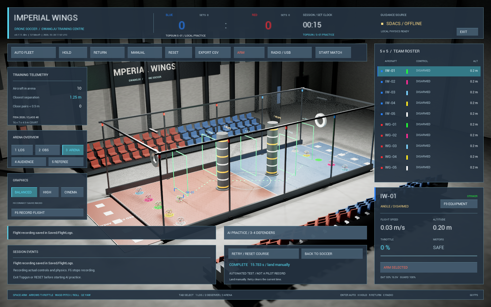

# 탑건 S-01 코스·완주 시간 — v0.7.11-dev

통합 계획 C단계 중 **코스·통과 판정·세션 타이머**를 구현했다. 두 기둥을 서로 반대쪽으로 도는
1회 S자 연습이다. 기존 실내 경기장을 연습 코스로 전환하며 공식 FIDA 경기 규칙과 별개다.
현재 시간은 화면과 선택적 F6 비행 기록에 남는다. **최고 기록 저장·닉네임/ID/국적·순위표·
LAN/온라인 기록방은 아직 없다.** 초기화·재시도·앱 종료 시 화면의 시간은 사라진다.

## 사용하는 순서

1. 개발 실행본에서 파일럿 시점을 선택하고 모든 기체를 착륙·DISARM한다.
   화면이 간소 모드이면 **F10**으로 패널을 연다.
2. 화면 아래 **TOPGUN / TWO-PYLON S-COURSE**를 누른다. 파란 공격수 IW-01과
   경기장 밖 LOS 시점으로 초기화된다. 기체는 자동으로 이륙하지 않는다.
3. 조종기 설정·입력 방향·최저 스로틀을 확인한 뒤 직접 ARM하고 이륙한다. 기존 Mode1/2,
   레이트·Expo·아밍 버튼 설정과 ANGLE35도 조종은 그대로다.
4. **START → GATE 1 → GATE 2 → GATE 3 → FINISH** 순서로 앞으로 통과한다.
   바닥의 점선이 경로를 연결하며 다음 게이트는 청록색, 통과한 게이트는 녹색이다.
   첫 기둥은 한쪽, 두 번째는 반대쪽으로 돌아야 한다. 게이트 높이 중앙1.8m가 연습 기준이다.
5. START에서 보호구 전체가 빠져나가면 시간을 시작한다. FINISH를 완전히 통과하면
   **COMPLETE**와 소수점3자리 시간이 고정된다. 이는 표시 정밀도이며 실제 밀리초 정확도 인증이 아니다.
6. 직접 착륙하고 DISARM한다. **RETRY / RESET COURSE**는 이번 시간을 지우고 새 시도를 준비한다.
   **BACK TO SOCCER**는 코스를 없애고 일반 연습으로 돌아간다. 비행 중 두 버튼의 실행은 거부된다.
   긴급 **RESET**은 언제든 현재 시도와 위치를 초기화한다.

F10 간소 화면에도 현재 게이트·완주/무효 이유를 표시한다. F6을 켜면
`FlightLogs/*.jsonl`에 코스 버전, 상태, 무효 이유, 누적 구간 시간, 자동 시험 여부를 기록한다.
정상 사용자 실행의 시간은 단조 증가하는 실제 시계를 사용한다. 자동 검사에서는 고정 게임 간격을
사용하고 화면/기록에 **AUTOMATED TEST / NOT A PILOT RECORD**를 명시한다.

## 코스와 판정

| 항목 | S-01-v1 설정 |
|---|---|
| 기둥 | x=-2m/+2m, y=0. 지름70cm·높이3.6m의 고정 충돌체2개 |
| 출발/결승 | (-5,0)/(5,0)m. 진행 방향 +X |
| 중간 게이트 | (-2,-1.5), (0,0), (2,1.5)m |
| 통과 구역 | 폭1.6m, 바닥 위0.6~3.0m, 판정 깊이10cm |
| 기체 | 지름40cm. 전후20cm와 판정 깊이 절반5cm를 포함해 완전 통과 확인 |
| 여유 | 중심이 게이트 중앙 좌우60cm 미만, 높이0.8~2.8m 내부에 있어야 함. 경계 접촉은 거부 |
| 시간 | START 완전 통과부터 FINISH 완전 통과까지. 이전/현재 위치 사이의 통과 시각을 보간 |
| 순서/방향 | 구역 밖 통과·구역 생략·완전 역통과는 무효. 진입 후 같은 쪽으로 되돌아 나온 미완성 접근은 새로 시도 가능 |
| 충돌 | 시간 측정 중 바닥·기둥·기체·골대 등 강체 접촉 이벤트가 오면 무효. 기둥은 움직이지 않으며 미끄럼/반발은 실제 Chaos 접촉 |
| 시간 이상 | 물리 시간 누락, 비정상 배속, 일시정지/긴 간격, 정상 실행에서 강제 고정 시간 또는 시계와 게임 간격 불일치 시 무효 |
| 입력/초기화 | 비행 중 DISARM·초기화는 시도를 종료. 기체 교체와 AI/군집/공식 경기 시작은 코스에서 거부 |

발광 사각형은 통과 구역 안내이며 물리 장애물은 아니다. 기둥은 검은 몸체와 밝은 띠의 자체 생성
메시이고, 제조사나 다른 게임의 모델을 복제하지 않았다. 기둥 바닥의 넓은 원판은 시각 장식이며
70cm 원통이 충돌 범위다. 기존 골대·바닥·기체·네트 모델을 유지한다. 현재 네트의 부드러운 힘
반응처럼 강체 접촉 이벤트가 없는 반응까지 모두 무효 처리한다는 뜻은 아니다.

## 실제 검사와 남은 범위

[검사 버전·수치·ZIP 지문](verification.md#topgun-0711), [검사별 근거](verification/topgun-course-2026-10-28.json).
자동 비행은 검사 전용이며 일반 탑건 모드에서는 활성화할 수 없다. 비행 검사는 위치를 순간 이동시키지
않고 기존 모터 힘으로 이륙·경로 통과·충돌·착륙했다. 새 시도 시작의 명시적 초기화만 사용했다.

다음 C단계는 닉네임·로컬 UUID·국적, 시도별 결과 저장/복원·실패 복구, 동일 조건의 최고 기록 비교다.
현재 코스를 인증된 경기·온라인 순위에 사용하지 않는다. 기체/중력/보조 설정의 비교 지문과 규칙 확정,
수동 실조종의 완주/시간 평가, 실제 다른 PC와 다기종 조종기 검사가 남았다. 별도120Hz PID 이관,
물리 실측 보정, 기둥 변형/파손, 벌점 방식·여러 바퀴·코스 편집기도 후속이다.

소스 브랜치는 `codex/topgun-training`이며 **공개 실행 ZIP v0.7.4-r2에는 이 기능이 없다.**
위 검증 기록의 v0.7.11 ZIP은 로컬 시험본이다. 이전 버전의 실물 조종기 시험을 이번 기능의 검사로 대신하지 않는다.
